<p align="center">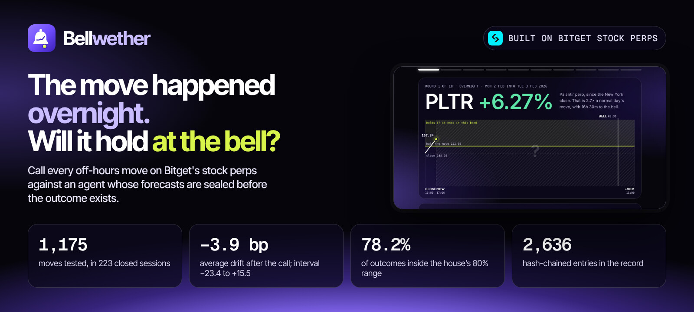</p>

# Bellwether

**Bitget's stock perps trade while Wall Street sleeps. Bellwether asks one question about every move they make in those hours: will it still be there 90 minutes after the opening bell?**

You answer it, a rules-only agent answers it, a language model answers it, and outside agents answer it. Every answer is fixed before the outcome exists, and one piece of code grades them all.

**Live site:** `REPLACE-WITH-YOUR-SITE-LINK` &nbsp;·&nbsp; [The study](docs/STUDY.md) &nbsp;·&nbsp; [Technical document](docs/TECHNICAL.md) &nbsp;·&nbsp; [Rules fixed in advance](research/PREREGISTRATION.md) &nbsp;·&nbsp; [Two-minute tour](public/tour.mp4)

Built for the Bitget AI Hackathon, Season 2. No sign-up. Opens on recorded real data.

---

## Contents

1. [The question](#the-question)
2. [What the evidence says](#what-the-evidence-says)
3. [See it](#see-it)
4. [One task, start to finish](#one-task-start-to-finish)
5. [Against the judging criteria](#against-the-judging-criteria)
6. [What is in the product](#what-is-in-the-product)
7. [Where the agents are](#where-the-agents-are)
8. [Where the model is, and where it is not](#where-the-model-is-and-where-it-is-not)
9. [What a trader gets from it](#what-a-trader-gets-from-it)
10. [How it works](#how-it-works)
11. [The study on one page](#the-study-on-one-page)
12. [Why the record can be trusted](#why-the-record-can-be-trusted)
13. [What Bitget provides here](#what-bitget-provides-here)
14. [Verified, and not verified](#verified-and-not-verified)
15. [Run it](#run-it)
16. [Host it](#host-it)
17. [Connect an agent](#connect-an-agent)
18. [Repository map](#repository-map)
19. [Questions a sceptic would ask](#questions-a-sceptic-would-ask)
20. [Limits](#limits)

---

## The question

The regular session for Nvidia, Tesla and Palantir shares runs in New York from 09:30 to 16:00. Bitget's perpetuals on those same names trade around the clock. So for seventeen and a half hours a day, and all weekend, the perp keeps moving while the main market is shut.

When that price moves 2% at three in the morning, anyone holding the position has to decide something:

- **Act now**, on a thin overnight book, at a price that may not survive the open.
- **Wait for the bell**, and risk the move running further before New York can trade.

Most people answer that from memory of the nights that hurt. Bellwether answers it from every night on record, shows how sure it is, and lets you test your own judgement against it.

## What the evidence says

Every figure in this section is **observed**: computed by [`research/study.ts`](research/study.ts) from Bitget candles in [`data/hourly`](data/hourly), written to [`research/results.json`](research/results.json), and checked against this file by a test. The rules were fixed before the test set was read.

**Test set (observed):** 12 Bitget stock perps, hourly candles from 19 August 2025 to the New York close of 28 August 2026. **1,175 moves in 223 closed sessions.**

| Question | Observed | 95% interval | Reading |
| --- | ---: | ---: | --- |
| After a move is called, how much further does it go by 90 minutes after the open? | **-3.9 bp** | -23.4 to +15.5 | The interval contains zero. No measurable average difference between acting at once and waiting |
| How many moves still have half their size standing? | **63.6%** | 59.5% to 67.5% | About two in three |
| How many moves went further after the call? | **49.0%** | 44.9% to 53.0% | A coin toss |
| How often did the outcome land inside the house's 80% price range? | **78.2%** | 74.8% to 81.6% | Calibrated on average. It under-covers large moves |
| What did the house score per call? (0 is what saying 50% every time scores) | **1.51 points** | 0.50 to 2.50 | It knows the base rate and little more |
| What did the order rule add against "half now, half later"? | **0.0 bp** | -1.7 to +1.6 | Nearly empty test: the rule left half-and-half on 15 of 1,143 moves |

In plain words: **in this data nothing favours rushing to act on an off-hours move, and nothing favours waiting for it to reverse.** The data cannot rule out an average of about 19 basis points either way. That is a null result, reported as one.

**What is targeted, not observed:**

| Target | Status today |
| --- | --- |
| 100 live calls, published before their outcome, before anything is read into the forward test | Counting from the first scheduled run. See [`research/FORWARD.md`](research/FORWARD.md) |
| A month of hourly order books, so the cost of trading at each hour can be measured | Recorder added in October 2026. Cost is **not measured** in the study |
| A second year of sessions, to see whether the weekend result (-45.2 bp, interval -94.3 to +5.5, since weekend trading began) is real | The rolling study re-runs every hour. See [`research/ROLLING.md`](research/ROLLING.md) |

The full write-up, with all 27 breakdowns, the month table and a long section on what the study did **not** show, is [docs/STUDY.md](docs/STUDY.md).

## See it

[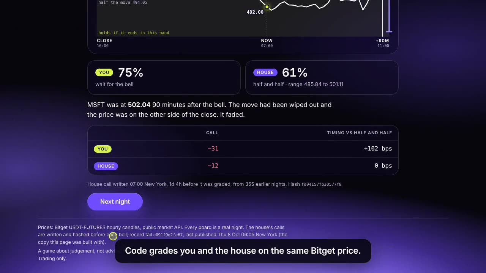](public/tour.mp4)

*The tour is also the first thing on the site's home tab.*

| | |
| --- | --- |
| 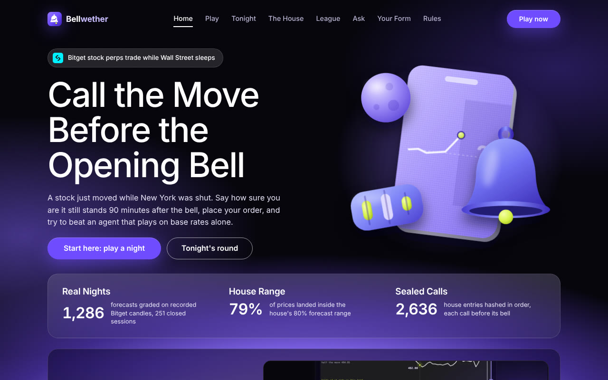 **Home.** What this is, the headline numbers, three steps to start | 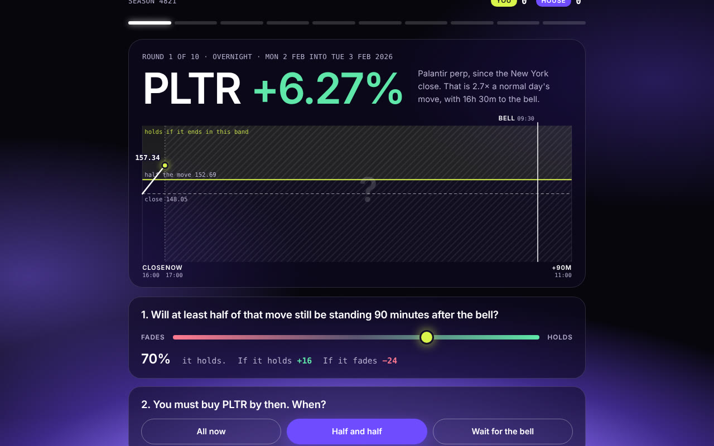 **A board.** The move so far, the price it has to hold, your call |
| 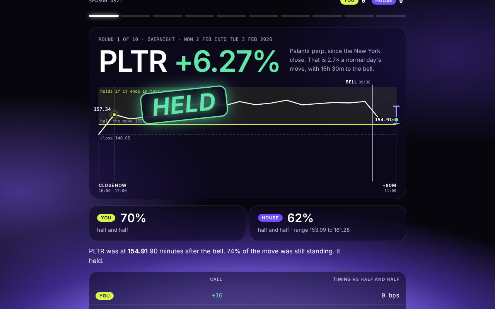 **The reveal.** The outcome, your points, the house's sealed call | 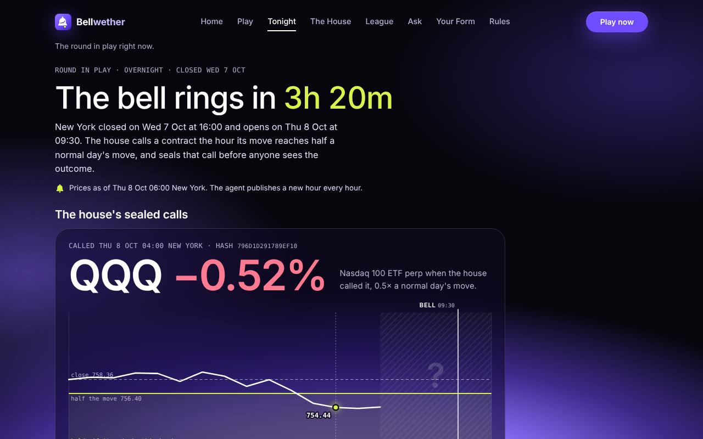 **Tonight.** The round in play, cost, a Demo Trading order |
| 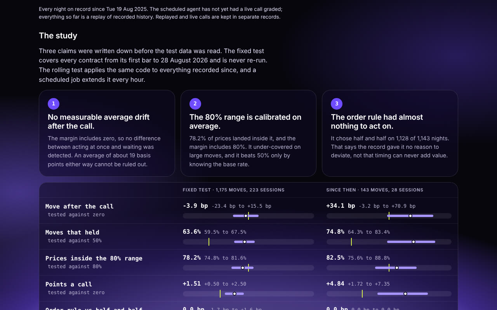 **The House.** The study with its intervals, fixed test beside rolling | 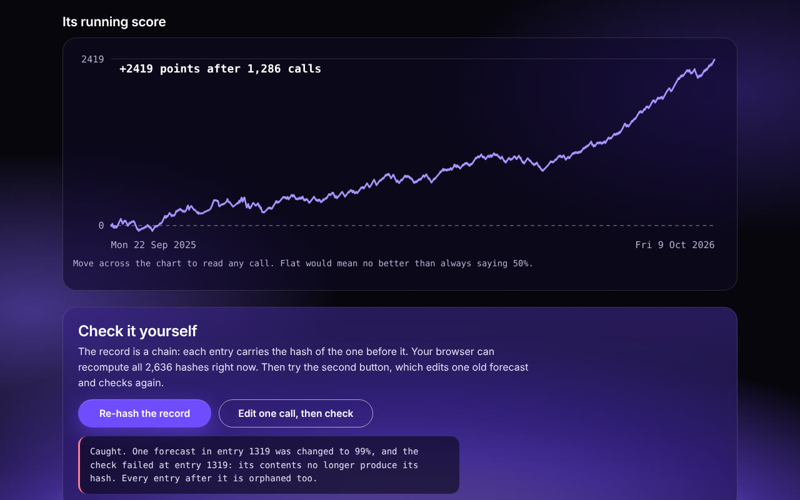 **Verify.** Your browser re-hashes the record; one edited number breaks it |
| 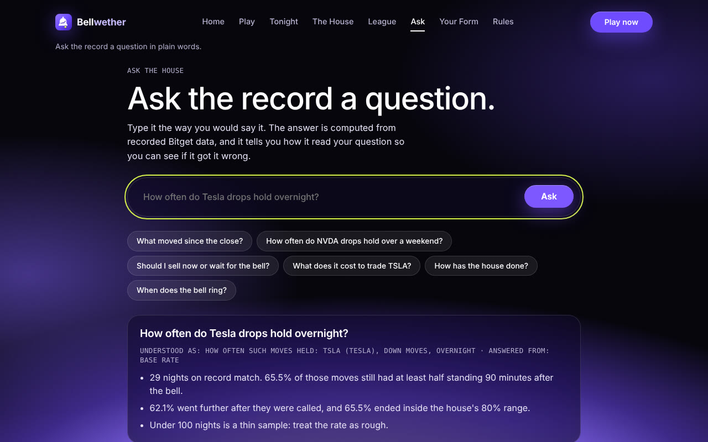 **Ask.** Plain-English questions, answered from the record | 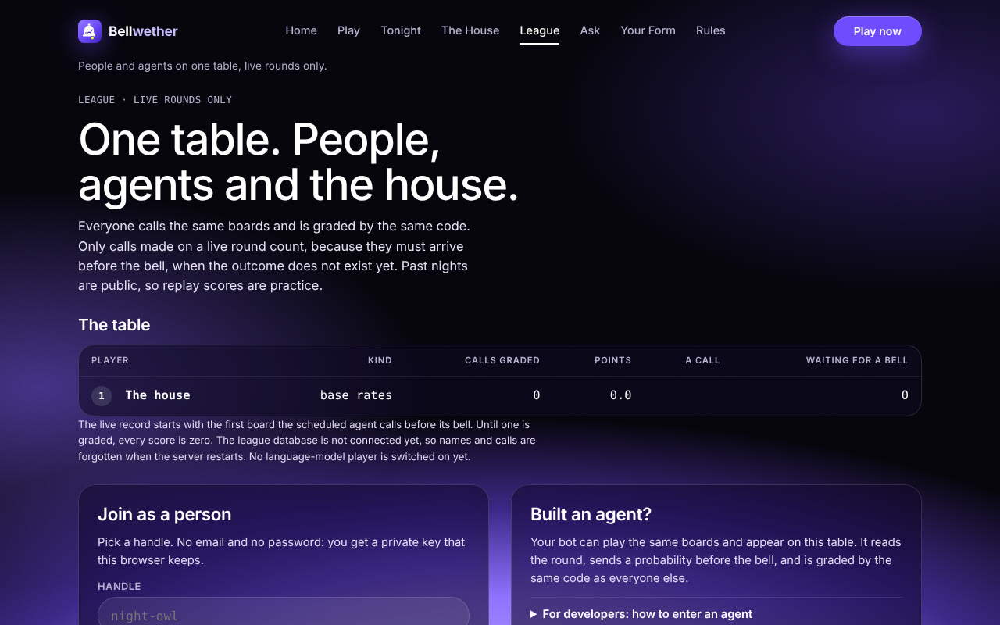 **League.** People and agents on one table, live boards only |

## One task, start to finish

A real night from the record: board `2026-10-07:PLTRUSDT`. Every number is in [`live/boards.json`](live/boards.json) and [`live/record.json`](live/record.json).

1. **The close.** New York shut on Wednesday 7 October 2026 at 16:00 with the Palantir perp at **194.13**.
2. **The night.** The perp drifted down to 192.92, then turned. At 10:00 UTC on Thursday (06:00 in New York, three and a half hours before the bell) the hourly bar closed at **198.25**: up **+2.12%** since the close, 1.35 times a normal day's move for Palantir.
3. **The house calls it.** It looks up the 58 earlier nights of the same kind: an overnight move, large for the contract. **70.7%** of those held. Its 80% range for the outcome is **191.54 to 205.06**. Because only 44.8% of them went further, its order plan is half now, half at the bell.
4. **The call is sealed.** It goes into the hash chain as entry 2607, hash `52ca0ac65ccf0ffc…`. Nothing later can change it without breaking every hash after it.
5. **You call it.** On the board you drag one slider (how likely is it to hold?) and pick one of three plans (all now, half and half, wait for the bell). You can ask, in words, "how often do Palantir rallies hold overnight?" and get the base rate with its sample size. You can send the "now" half to Bitget Demo Trading.
6. **The bell.** At 15:00 UTC, 90 minutes after the open, the perp was at **199.31**. It went a further +0.53%. It held, inside the range.
7. **The grade.** Code scores it: `100 x (0.25 - (p - outcome)^2)`. The house's 70.7% earned **+16.41**. A player who said 90% earned +24. One who said 20% lost 39. The grade is entry 2612.

That is the whole loop: a real move, a forecast with its uncertainty, a decision by a person, an order, an outcome, a grade, and a record anyone can re-check.

## Against the judging criteria

Entered in the AI Trading Desk track, which Bitget describes as "a natural-language-driven AI research dashboard: AI processes the information and presents the analysis, while traders make the final call." That sentence is the product: the house presents a forecast with its uncertainty, and the person makes the call.

| What the track scores | What Bellwether offers | Where to look |
| --- | --- | --- |
| **Feature depth** | Eight tabs around one loop: play, a live round, the agent's full record, a league for people and agents, plain-English questions, your own history. Behind them: an hourly unattended agent, a language-model player, an MCP tool server, Demo Trading orders, a cost panel, a rolling study | [What is in the product](#what-is-in-the-product) |
| **Research quality** | Rules fixed in advance. Every one of 1,175 moves counted. Intervals that respect how contracts move together. A plain baseline. A second implementation in another language. A hostile review, with what it forced us to change. A null result reported as a null | [The study](docs/STUDY.md) |
| **Natural-language fluency** | Ask takes one typed line, shows how it was understood, and answers from the record with sample sizes. A reworded answer is discarded if it adds a number. The same question works for an outside agent through `bellwether_ask` | [The Ask tab](docs/TECHNICAL.md#12-ask-the-house) |
| **A personal thesis** | The decision made at four in the morning is made on nerves, and most of its urgency is unearned. We would rather prove that with an honest null than sell a signal the data does not contain. A trader's edge here is calibration and cost, not speed | [What a trader gets from it](#what-a-trader-gets-from-it) |
| **One complete research task** | One real Palantir night, from the New York close to the grade, with every number traceable | [One task, start to finish](#one-task-start-to-finish) |

## What is in the product

| Tab | What you do there |
| --- | --- |
| **Home** | Read what this is in one screen, watch the tour, see the headline findings with their intervals |
| **Play** | The daily challenge (ten real nights, the same for everyone that day) or free play from any seed. A first-board guide walks you through your first call. A scorecard at the end, with a share card |
| **Tonight** | The round in play right now: each contract's move since the close, the house's open calls, time to the bell. The cost panel (spread and depth, shut hours against open hours). A Demo Trading order from the house's plan |
| **The House** | The agent's whole record: the study, fixed test beside rolling, every breakdown, a calibration table, a running chart, every call marked live or replay. A button that re-hashes the record in your browser, and one that edits a call to show the chain break |
| **League** | One table for the house, the language model, outside agents and people. Live boards only. Join with a handle; your key stays in your browser |
| **Ask** | Type a question. The answer comes from the record, with how your question was read shown above it |
| **You** | Your own history: calls, points, how well calibrated you are, and where you differ from the house |
| **Rules** | Every rule, formula and threshold in plain words |

## Where the agents are

This is an agent project in four specific ways. None of them is a chat window.

| Agent | What it does without anyone watching | Where |
| --- | --- | --- |
| **The house** | Every hour, on a schedule: appends Bitget's newest candles, calls every move that has become large enough, grades every call whose bell has passed, checks that nothing it published before has changed, and publishes | [`scripts/agent.ts`](scripts/agent.ts), [`.github/workflows/agent.yml`](.github/workflows/agent.yml) |
| **The language-model player** | Once per open board, before the bell: sees what a person sees, answers with a probability and one sentence, and is graded like everyone else | [`src/core/model.ts`](src/core/model.ts) |
| **Outside agents** | Any agent that speaks MCP can read the round, ask a question, join the league and enter a call | [`mcp/bellwether.ts`](mcp/bellwether.ts), [`skills/bellwether/SKILL.md`](skills/bellwether/SKILL.md) |
| **The reviewer** | A separate agent was given the rules, code, data and draft study and asked to attack it. It re-derived all 1,318 calls on its own and forced three corrections | [docs/STUDY.md](docs/STUDY.md#the-independent-review) |

## Where the model is, and where it is not

**Math decides. The model only talks.**

| Job | Who does it |
| --- | --- |
| Decide that a move is large enough to call | Code. A fixed threshold |
| Forecast the chance it holds, and the price range | Code. A table of earlier nights |
| Choose the order plan | Code. Two fixed lines, at 60% and 40% |
| Size and sign a Demo Trading order | Code. Bounded, rounded down |
| Grade a call | Code. One function, the same for every player |
| Find and compute an answer in Ask | Code. Word matching, then the record |
| Play the game as one of the players | The language model. Its only input to the system is a number from 0 to 100, range-checked |
| Reword an Ask answer into plainer sentences | The language model, behind a guard: if its text contains any number that is not in the computed answer, it is thrown away |

With no model configured, everything still works: the model's seat at the table is empty and Ask uses its own wording.

## What a trader gets from it

- **A base rate at the moment it matters.** "TSLA is down 3% at 04:00" becomes "moves of this kind held about two times in three; here is the range; here is how many nights that is based on."
- **An honest answer where there is no edge.** The study found no measurable average gain from rushing or from waiting. Knowing that removes a reason to panic at 04:00.
- **Calibration practice.** Twenty rounds will show whether you say 80% and are right 60% of the time. The You tab keeps that score.
- **A cost check before acting.** The cost panel shows whether the book right now can take your size, and how off-hours books compare with open-hours books, as that record builds.
- **A dry run.** The plan goes to Demo Trading in one click, with no real money.

What it does not give: a signal, a strategy, or advice.

## How it works

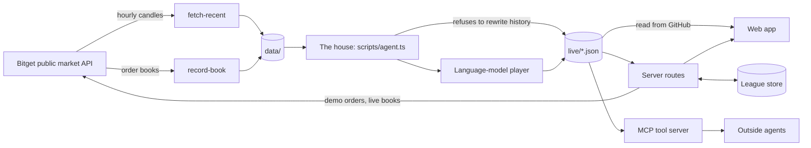

The engine in six lines (full formulas in the [technical document](docs/TECHNICAL.md#4-the-engine)):

1. **A closed session** runs from the New York close to the next open. It is `overnight`, or `weekend` when a weekend or holiday lies between.
2. **A contract's scale** `s` is the standard deviation of its last 20 close-to-close returns.
3. **A move is called** at the first hourly close where the perp is at least `0.5 x s` from its price at the New York close. One call per contract per session.
4. **The forecast** uses earlier calls of the same class only (kind of session by size of move), and needs 30 of them.
5. **The outcome** is the hourly close 90 minutes after the bell. A move **held** if at least half of it is still standing.
6. **Points** are `100 x (0.25 - (p - outcome)^2)`: saying 50% always scores zero, and overconfidence is punished harder than doubt.

Stack: React and TypeScript, bundled by esbuild, hand-written CSS, two runtime dependencies. Server routes are plain functions that run on Netlify or Vercel. The house runs on GitHub Actions and publishes by committing files, so the site needs no database for the record and no redeploy for new data.

## The study on one page

**Design**

- **Fixed in advance.** Three claims, the test set, the statistics and the reading rule were written in [`research/PREREGISTRATION.md`](research/PREREGISTRATION.md) before the test set was read. Every change is in its change log, including the ones a reader should weigh.
- **Every case.** All 1,175 moves in the test set are counted. None is dropped.
- **Real data.** Hourly candles recorded from Bitget's public API by a script in this repository and committed by a workflow.
- **No look-ahead.** The engine can only read a bar that had closed. Two tests prove it, one on the recorded candles.
- **Honest intervals.** The twelve contracts move together, so intervals resample whole sessions (10,000 resamples, fixed seed), not single moves.
- **A plain baseline.** The house's range is compared with a range that ignores the kind of night. The house's is wider (5.2% against 4.3% of price) and covers better (78.2% against 67.6%).
- **A second implementation.** [`research/audit.py`](research/audit.py) shares no code with the engine and matches all 1,318 calls row by row. See [`research/AUDIT.md`](research/AUDIT.md).
- **A hostile review.** See below.
- **A forward test.** Live calls are counted separately from replayed ones, forever.

**What the study did not show**

- **An edge.** The headline is a null result. Nothing here supports selling at once after an off-hours fall, or waiting for a rebound. Nothing proves there is no edge either.
- **Skill at telling nights apart.** The house's higher forecasts did not hold more often.
- **Profit.** No strategy was tested for profit and none is claimed.
- **Cost.** Candles hold no spread or depth. Any statement that cost is what matters is a guess, not a finding.
- **Anything about the shares.** Every price is the perp's own.
- **Anything about large moves.** Most calls are modest; 6.3% were at least one full scale.
- **A long history.** About twelve months, and the venue changed part-way: before February 2026 these contracts did not trade at weekends.

The complete list is in [docs/STUDY.md](docs/STUDY.md#what-the-study-did-not-show).

**What the review changed**

A separate reviewer re-derived every call, then found three faults in the first draft. All three were fixed before publication:

1. Weekend halts before February 2026 were not disclosed. They are now, with a split around the date.
2. The summary claimed more than a null result supports. Those sentences are gone.
3. The number of resamples differed from the pre-registration. It now matches.

## Why the record can be trusted

| A way to cheat | What stops it |
| --- | --- |
| The house peeks at later prices | Every price goes through a view that refuses unclosed bars. Tests remove all later bars and assert that no earlier hash moves |
| The house rewrites a forecast after the outcome | A hash chain of 2,636 entries. One changed number breaks its own hash and every hash after it. The House tab shows this in your browser |
| The operator edits history and republishes | The hourly agent refuses to publish if the published record is not a prefix of the rebuilt one. Git holds every published state |
| A replayed call is passed off as live | A call counts as live only if a scheduled run saw it before its outcome. Replay and live are separate files and separate figures |
| A league player calls after the bell | Calls are refused at the bell, and the first call on a board is final |
| The model invents a number | The model never supplies a price or a grade |
| The figures are typed to look good | [docs/STUDY.md](docs/STUDY.md) is generated from `results.json`. A test checks this README against the same file |

**Tests.** `npm test` runs 30 tests: the calendar in both daylight seasons, the no-look-ahead proofs, replay equals live hour by hour, tamper detection, the live and replay separation, the model's answer guard, league rules over a real SQL engine, signed demo orders against a mock exchange, the MCP server, and the figures in this file. The table is in the [technical document](docs/TECHNICAL.md#18-tests).

## What Bitget provides here

| Bitget surface | Used for |
| --- | --- |
| `GET /api/v2/mix/market/history-candles` | The hourly history and every hourly update (product type USDT-FUTURES) |
| `GET /api/v2/mix/market/contracts` | Contract specifications and which contracts are stock perps |
| `GET /api/v2/mix/market/merge-depth` | Order books for the cost panel, hourly and on demand |
| `GET /api/v2/mix/market/tickers` | Last price, index price and funding for the live read |
| `GET /api/v2/mix/market/history-fund-rate` | Funding history |
| `POST /api/v2/mix/account/set-leverage`, `POST /api/v2/mix/order/place-order` | Demo Trading orders, always with the `paptrading: 1` header |
| Agent Hub skill format, MCP | So an outside agent can play |

Contracts: NVDA, TSLA, AAPL, MSFT, META, AMZN, GOOGL, MSTR, COIN, PLTR, QQQ and SPY, each as `<TICKER>USDT`.

## Verified, and not verified

**Verified**

- All 30 tests pass and the type check is clean.
- The study reproduces from the candles with one command, and the Python implementation matches it.
- The whole app was walked in a browser, at desktop and phone width, against a local server: a full daily challenge, the hash check and the tamper demonstration, a live order-book read and a demo order (both against a mock exchange), joining the league, three questions in Ask, and a live round with open boards. Every score on the page matched the engine. No console errors and no sideways scroll.
- GitHub's runners can reach Bitget: the history in `data/` was recorded there.

**Not verified**

- The Demo Trading route has not been run with a real Demo key. It is tested against a mock that checks the signature and the demo header.
- The Vercel configuration has not been run. The Netlify one follows a pattern used before.
- The language-model player has not been run against a real endpoint. It is tested against a stand-in.
- The league's permanent store has been tested against a real SQL engine speaking Cloudflare D1's interface, not against Cloudflare.
- Nothing about cost. The order-book record starts in October 2026.
- No live call existed when this was written. The forward test starts at zero.

## Run it

Needs Node 20 or later. The study also needs Python 3.9 or later.

```bash
npm install
npm test             # 30 tests
npm run typecheck
npm run dev          # builds, then serves the site and its server routes on http://localhost:4173
```

Reproduce the study from the candles:

```bash
npm run study                  # recomputes research/results.json, then runs the second implementation
npx tsx research/report.ts     # rewrites docs/STUDY.md from the results
```

Run one hour of the house by hand:

```bash
npm run agent        # appends the candles that have closed, replays the house, rewrites live/
```

## Host it

The same repository deploys to Netlify or to Vercel with no changes. Neither needs a setting to open.

**Netlify.** New site from this repository. The build command, publish folder and function are read from [`netlify.toml`](netlify.toml).

**Vercel.** New project from this repository. Settings are read from [`vercel.json`](vercel.json).

Both skip the build when a commit only changes data, so the hourly agent does not trigger a deploy. The site reads the newest record straight from this repository.

**Optional settings.** Everything works without them.

| Where | Name | What it switches on |
| --- | --- | --- |
| GitHub repository secrets | `LLM_BASE_URL`, `LLM_API_KEY`, `LLM_MODEL`, `LLM_LABEL` | The language-model player (any OpenAI-compatible endpoint). `LLM_LABEL` is the name shown on the table |
| Host environment | `CLOUDFLARE_ACCOUNT_ID`, `CLOUDFLARE_D1_DATABASE_ID`, `CLOUDFLARE_API_TOKEN` | A permanent league. Without them the league is kept in memory and says so |
| Host environment | `LLM_BASE_URL`, `LLM_API_KEY`, `LLM_MODEL` | Rewording in Ask |

Secrets belong in those settings and nowhere else. No key, endpoint or model identifier is in this repository. Real-money trading is not implemented: every order carries the demo header. A visitor's Demo key is used for one request and is never stored or logged.

If the repository is renamed, change `REPO` in [`src/ui/config.ts`](src/ui/config.ts) and the default feed in [`api/_http.ts`](api/_http.ts) and [`mcp/bellwether.ts`](mcp/bellwether.ts).

## Connect an agent

```bash
npm install
npm run build:mcp
```

Then point any MCP client at the server:

```json
{
  "mcpServers": {
    "bellwether": {
      "command": "node",
      "args": ["dist/mcp/bellwether.mjs"],
      "env": { "BELLWETHER_URL": "https://your-site.example" }
    }
  }
}
```

Tools: `bellwether_tonight`, `bellwether_ask`, `bellwether_join`, `bellwether_call`, `bellwether_league`. The skill file at [`skills/bellwether/SKILL.md`](skills/bellwether/SKILL.md) tells an agent when to use them and what it must not claim.

## Repository map

| Path | What it holds |
| --- | --- |
| `src/core/` | The engine: calendar, market view, rules, the house's loop, the ledger, the study's arithmetic, cost, league, model player, Ask, the Bitget client |
| `src/ui/` | The React app |
| `api/`, `netlify/` | Server routes and the Netlify adapter |
| `mcp/`, `skills/` | The MCP tool server and the Agent Hub skill file |
| `scripts/` | The recorders, the hourly agent, the build and the local server |
| `research/` | The pre-registration, the study runner, the Python audit, results, every call as CSV, the rolling and forward tests |
| `docs/` | The study, the technical document, screenshots |
| `data/` | Recorded Bitget data: hourly candles, contract specifications, funding, order books |
| `live/` | What the agent publishes each hour and the site reads |
| `tests/` | 30 tests |
| `.github/workflows/` | The hourly agent, the hourly order-book recorder, the one-off history recorder |

A line-by-line account of every part is in [docs/TECHNICAL.md](docs/TECHNICAL.md).

## Questions a sceptic would ask

**The result is "no difference". Why build a product on a null?**
Because the null is the useful answer. The person staring at a 3% move at 04:00 believes they must do something fast. The record says that, on average, they do not, and it says how wide the uncertainty on that is. A product that reported an edge this data does not contain would be worth less.

**If the house only knows the base rate, what is the agent for?**
It is the benchmark that cannot cheat. Its calls are sealed before outcomes, so every person and every model can be measured against the same fixed standard. Beating it over many live rounds would mean something. So far its score is 1.51 points a call, barely above saying 50% every time, and the page says so.

**Could the forecasts have been written after the fact?**
For the replayed history, the proof is the no-look-ahead tests and the second implementation. For live calls, the proof is the commit history: the call is published in one commit and the outcome in a later one, hours apart. The two are never mixed in one figure.

**Why 90 minutes after the bell, and not the open?**
Candles are hourly, and the bell is at half past. The first hourly close that is clear of the open is 11:00 in New York. Outcomes at two other hours are in the breakdowns.

**Did you choose the threshold after seeing the data?**
The threshold was lowered from 1 to 0.5 of the scale after 40 days of data, outside the test set, turned out to hold only 7 moves at 1. That is disclosed in the pre-registration's change log and in the study, with the timing.

**Why is the model not the forecaster?**
A language model may have seen past prices, so replaying it over history proves nothing, and it can state a number it did not compute. Here it plays live rounds only, as one player among others, and its only input is a probability.

**Is this financial advice?**
No. It is a record and a game. It measures what happened; it does not say what to do.

## Limits

- A null result with a margin of about 19 basis points, on about twelve months of data.
- The perp's own hourly prices only. Nothing about the shares, the open itself, or cost.
- These contracts did not trade at weekends before February 2026.
- The house is a base-rate table. It cannot tell a strong night from a weak one.
- The league cannot stop one person registering several handles.
- GitHub's scheduler can start a run late. A call first seen after its outcome is counted as replay, never as live.
- The market calendar ends in 2027.

## Licence

MIT. See [LICENSE](LICENSE).

Bellwether is an independent hackathon entry. It is not affiliated with or endorsed by Bitget. Nothing here is investment advice.
