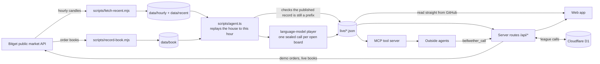

# Bellwether: technical document

This document says how every part works, with the formulas, thresholds and file formats, so that a reader can check any figure the product shows. The study has its own document: [STUDY.md](STUDY.md).

## Contents

1. [What the system is](#1-what-the-system-is)
2. [Repository map](#2-repository-map)
3. [The clock](#3-the-clock)
4. [The engine](#4-the-engine)
5. [A worked example](#5-a-worked-example)
6. [The record](#6-the-record)
7. [The hourly agent](#7-the-hourly-agent)
8. [The files the site reads](#8-the-files-the-site-reads)
9. [The study pipeline](#9-the-study-pipeline)
10. [The league](#10-the-league)
11. [The language-model player](#11-the-language-model-player)
12. [Ask the house](#12-ask-the-house)
13. [The cost panel](#13-the-cost-panel)
14. [Demo orders](#14-demo-orders)
15. [The agent tool server](#15-the-agent-tool-server)
16. [The front end](#16-the-front-end)
17. [Trust model](#17-trust-model)
18. [Tests](#18-tests)
19. [Configuration and hosting](#19-configuration-and-hosting)
20. [Known limits](#20-known-limits)

## 1. What the system is

Bitget's stock perpetuals trade around the clock. The shares behind them trade in New York from 09:30 to 16:00. Bellwether asks one question about the hours in between: when a perp moves while New York is shut, is the move still there 90 minutes after the opening bell?

Four things answer it:

- **The house**: a deterministic agent that calls each move the hour it becomes large enough, forecasts from earlier nights only, and is graded by code. No language model takes part in its decisions.
- **The record**: an append-only hash chain of every call and every grade.
- **The study**: three claims fixed in advance and tested on the recorded history, then re-run every hour on new data.
- **The game**: people, a language-model player and outside agents call the same boards and are graded by the same code.



Everything above the web app runs on GitHub Actions on a schedule, with nobody watching. The web app has no database of its own for the house: it reads the files the agent commits.

## 2. Repository map

| Path | What it holds |
| --- | --- |
| `src/core/calendar.ts` | New York sessions in UTC: trading days, holidays, daylight time, closed windows, decision hours |
| `src/core/market.ts` | Hourly bars and the view that refuses any bar that had not closed |
| `src/core/rules.ts` | Scale, forecast, outcome, points, order plan, timing gain |
| `src/core/agent.ts` | The house's loop: grade what is due, then call what has moved |
| `src/core/ledger.ts`, `sha256.ts` | The hash chain and a dependency-free SHA-256 |
| `src/core/live.ts` | Turns the house's state into the files the site reads; marks which calls were live |
| `src/core/study.ts` | The study's arithmetic: rows, session bootstrap, the three claims, month table |
| `src/core/book.ts` | Spread and depth from an order book; the cost panel |
| `src/core/model.ts` | The language-model player: prompt, answer guard, chat client |
| `src/core/league.ts`, `store.ts` | League rules and storage (Cloudflare D1 or memory) |
| `src/core/ask.ts` | "Ask the house": question matching and answers from the record |
| `src/core/bitget.ts` | Server-side Bitget client: order books and signed demo orders |
| `src/core/season.ts`, `board.ts` | Seeded dealing; the shape of a board |
| `src/ui/` | The React app |
| `api/`, `netlify/api.ts` | Server routes; the Netlify adapter that serves them from one function |
| `mcp/bellwether.ts`, `skills/bellwether/SKILL.md` | MCP tool server and Agent Hub skill file |
| `scripts/fetch-history.mjs` | Records the full history once |
| `scripts/fetch-recent.mjs`, `record-book.mjs`, `agent.ts` | The hourly jobs |
| `research/` | Pre-registration, study, second implementation, results, rolling and forward reports |
| `data/hourly`, `data/recent`, `data/book` | Recorded candles (frozen), candles appended since, order-book snapshots |
| `live/` | What the agent publishes each hour |
| `tests/` | 30 tests |

## 3. The clock

All times in the engine are UTC milliseconds. New York hours are converted once, in `calendar.ts`.

| Moment | New York | UTC, daylight time | UTC, winter time |
| --- | --- | --- | --- |
| Cash close of day D | 16:00 | 20:00 | 21:00 |
| First decision hour | 17:00 | 21:00 | 22:00 |
| Last decision hour | 08:00 | 12:00 | 13:00 |
| The bell, day N | 09:30 | 13:30 | 14:30 |
| Grade | 11:00 | 15:00 | 16:00 |

- **Trading days** are weekdays that are not NYSE full-day holidays. The holiday list covers August 2025 to the end of 2027 and is in the source; a date outside it throws, so the engine cannot silently run on an unknown calendar.
- **Daylight time** runs from the second Sunday of March to the first Sunday of November, computed, not listed.
- **A closed window** runs from the close of trading day D to the open of the next trading day N. It is `overnight` when N is the next calendar day and `weekend` (weekend or holiday) otherwise.
- **Early closes** (the day after Thanksgiving, Christmas Eve) are left out as windows, on both sides. Their 13:00 close is still used as that day's close when the scale is computed.
- **Decision hours** are every hour from one hour after the close up to 90 minutes before the bell, inclusive. Every one falls on the hour in UTC, in both seasons; a test asserts it.

Bars are labelled by their opening time, so "the price at 21:00" is the close of the bar that opened at 20:00.

## 4. The engine

### 4.1 The view

```ts
closeAt(symbol, end)  // close of the hourly bar that ENDS at `end`
```

returns `undefined` when `end > now`. Every price the engine reads goes through this function with `now` fixed at the hour being processed. That single refusal is the whole of the no-look-ahead rule.

### 4.2 Scale

For contract *k* on trading day D:

```
r_i  = C(d_i) / C(d_(i-1)) - 1          for consecutive trading days up to D
s    = sample standard deviation of the last 20 such returns
```

`C(d)` is the perp's price at the cash close of day *d*. With fewer than 10 returns the contract is not eligible in that window. Nothing after D's close is read.

### 4.3 A call

At each decision hour *h* of a window, for each eligible contract not yet called in that window:

```
C0 = price at the cash close of D
P  = price at h
m  = P / C0 - 1
```

The house calls the contract at the first *h* where `|m| >= 0.5 x s`. At most one call per contract per window. The call records `C0`, `s`, `m`, `P`, the window, and a size class: `small` if `|m| < s`, else `large`.

### 4.4 The forecast

The forecaster's memory is the list of graded calls from **earlier windows only** (a window's calls are graded after its bell, which is always before the next window's close).

```
pool = earlier calls with the same kind (overnight | weekend) and the same size class
if fewer than 30:  pool = all earlier calls
if fewer than 30:  no forecast
```

For each earlier call *j* in the pool, `v_j = Y_j / s_j` (its outcome in units of its own scale). Then:

```
range   = P x (1 + sign(m) x quantile(v, 0.10) x s)   to   P x (1 + sign(m) x quantile(v, 0.90) x s)
pHold   = share of the pool that held
q       = share of the pool with Y > 0
```

`quantile` is linear interpolation between order statistics (the common "type 7"). The range is an 80% range for the outcome price.

### 4.5 The outcome

At the grade hour (90 minutes after the bell):

```
P_out    = price at the grade hour
Y        = sign(m) x (P_out / P - 1)             how far it went after the call, in its own direction
retained = (P_out / C0 - 1) / m                   share of the move still standing
held     = retained >= 0.5
```

If the grade bar is missing the call is graded `void` and counted.

### 4.6 Points

A player who says "probability *p* that it holds" scores

```
points = 100 x (0.25 - (p - o)^2)        o = 1 if it held, 0 if not
```

This is a Brier score turned so that higher is better and 50% is zero. It is a proper scoring rule: a player's expected score is highest when *p* is what they actually believe. Certainty earns +25 when right and costs 75 when wrong.

### 4.7 The order plan and its timing score

For an order in the direction of the move (sell after a fall, buy after a rise), `f` is the share done at the call and the rest is done at the grade hour:

```
f = 1    if q >= 0.6
f = 0    if q <= 0.4
f = 0.5  otherwise

gain over half and half = (f - 0.5) x Y
gain over all at the call = (f - 1) x Y
gain over all later       = f x Y
```

For an order against the move the rule is mirrored and the score is the same. Prices are hourly closes. No trading cost and no funding payment is charged.

### 4.8 The loop

`tick(market, state, now, config)` walks forward one hour at a time from `state.cursor` to `now`. At each hour *t*, with a view fixed at *t*:

1. **Grade** every open call whose grade hour is at or before *t*, append a `grade` entry to the ledger, and add the call to the forecaster's memory. For the window whose grade hour is *t*, also note each contract that was never called (the study's baseline).
2. **Call** every eligible contract that reaches the threshold at *t*, forecast it, and append a `call` entry.

The function is deterministic: the same candles and the same state give the same ledger. Replay is one call to `tick` with `now` at the end of the data. Live is the same function called every hour. A test proves the two give identical ledgers.

## 5. A worked example

Every number below is in `live/boards.json` and `live/record.json` under the board id `2026-10-07:PLTRUSDT`.

- New York closed on Wednesday 7 October 2026 at 16:00 (20:00 UTC). PLTRUSDT was at **194.13**. That is `C0`.
- Palantir's scale that day was **0.015741**: a normal day's move was about 1.57%. The house would call at half of that, 0.79%.
- The perp drifted lower through the night, to 192.92 at 03:00 New York (a move of -0.62%, under the threshold), then turned.
- At 06:00 New York on Thursday (10:00 UTC) it closed the hour at **198.25**: `m = 198.25 / 194.13 - 1 = +2.12%`, which is 1.35 x the scale. The house called it. Size class: `large`.
- 58 earlier calls were `overnight` and `large`. Of those, **70.7%** had held, and 44.8% had gone further. The 80% range from their outcomes, rescaled to Palantir's scale, was **191.54 to 205.06**. Because 44.8% is between 40% and 60%, the plan was half and half.
- The call was appended to the ledger as entry 2607, hash `52ca0ac65ccf0ffc…`, three and a half hours before the bell.
- At 11:00 New York (15:00 UTC) the perp was at **199.31**. `Y = 199.31 / 198.25 - 1 = +0.53%`. `retained = (199.31 / 194.13 - 1) / 0.021223 = 1.26`. It held, and the price was inside the range.
- The house's points: `100 x (0.25 - (0.7069 - 1)^2) = +16.41`. A player who had said 90% would have scored +24; one who had said 20% would have scored -39.
- The grade was appended as entry 2612.

## 6. The record

An entry is

```json
{ "seq": 2607, "at": 1791453600000, "kind": "call", "body": { … }, "prev": "<hash of entry 2606>", "hash": "<its own hash>" }
```

```
hash = SHA-256( prev + canonical({ seq, at, kind, body }) )
```

`canonical` is JSON with object keys in sorted order and `undefined` values dropped, so the same content always produces the same text. The first entry's `prev` is 64 zeros. SHA-256 is implemented in `sha256.ts` with no dependencies, so the browser, the server and the tests hash identically; a test checks it against Node's own.

`firstBreak(ledger)` recomputes every hash and returns the index of the first entry that does not follow from the one before it. It also rejects an entry whose time is earlier than its predecessor's. The site's House tab runs it in the reader's browser on the whole record, then again on a copy in which one old forecast has been changed.

**Replay and live are separate files.** `live/record.json` is the replayed record and never changes once the boundary is set. `live/record-live.json` holds every entry from the first live call onward. Joined, they are one intact chain.

**What makes a call live.** `live/seen.json` maps a call's id to the time a scheduled run first saw it. A call is live only if that run happened before the call's grade hour, that is, before its outcome existed. A call already graded the first time it is seen is replay, whenever it was made. The git history of `live/` shows each live call committed before its bell.

## 7. The hourly agent

`.github/workflows/agent.yml` runs at 12 minutes past every hour:

1. `node scripts/fetch-recent.mjs` appends the hours that have closed to `data/recent/<SYMBOL>.csv`. `data/hourly` is never rewritten, so the study's inputs cannot change. A response with an impossible bar (a non-positive price, or a range that does not contain its open and close) aborts that contract's append.
2. `npx tsx scripts/agent.ts`:
   - loads `data/hourly` and `data/recent` and replays the house from the first candle to this hour;
   - verifies the rebuilt ledger;
   - **checks that the record published last time is an exact prefix of the rebuilt one.** If Bitget revised an old candle, or a file was edited, the hash at the join differs, the script throws, and nothing is written;
   - marks newly seen open calls as live;
   - asks the language-model player for one call on each open board it has not yet called, if a model is configured and the bell has not rung;
   - aggregates the order-book snapshots into the cost panel;
   - re-runs the three study claims on everything recorded since the fixed test set ended;
   - writes `live/*.json`, `research/FORWARD.md` and `research/ROLLING.md`, each only if its content changed.
3. The workflow commits `data`, `live` and the two reports.

`.github/workflows/record-book.yml` runs at 7 minutes past every hour and appends one order-book snapshot per contract to `data/book/<date>.jsonl`.

`.github/workflows/fetch-history.yml` is run by hand, once, to record the full history.

Both workflows share one concurrency group, so they queue and never push at the same moment.

## 8. The files the site reads

| File | Written | Contents |
| --- | --- | --- |
| `live/summary.json` | hourly | Counts; coverage, hold rate and points for all, replay and live calls; ledger length and tail hash; the model player's tally; the study's headline figures |
| `live/tonight.json` | hourly | The window in play, each contract's move since the close, and the house's open calls with their price paths |
| `live/boards.json` | when the replay grows | Every replayed, graded call that had a forecast, with its hourly path from the close to the grade |
| `live/boards-live.json` | when a live call is graded | The same for live calls |
| `live/record.json`, `record-live.json` | as above | The ledger, replay and live |
| `live/seen.json` | when a call is first seen | Which calls were live, and the replay/live boundary |
| `live/model.json` | when the model calls | The language-model player's own hash chain |
| `live/league.json` | hourly | The boards in play and the outcomes of live calls: what the league needs to grade a call |
| `live/cost.json` | hourly | Latest spread and depth per contract, and medians for closed hours and cash hours |
| `live/study.json` | hourly | The fixed test's results, the rolling test's results and the month table |

## 9. The study pipeline

| Step | Command | Reads | Writes |
| --- | --- | --- | --- |
| Study | `tsx research/study.ts` | `data/hourly` only | `research/results.json`, `events.csv`, `quiet.csv` |
| Second implementation | `python3 research/audit.py` | `data/hourly`, `results.json`, `events.csv` | `research/AUDIT.md`; exits 1 on any mismatch |
| Report | `tsx research/report.ts` | `results.json`, `data/manifest.json` | `docs/STUDY.md` |
| Rolling and forward | `tsx scripts/agent.ts` (hourly) | `data/hourly`, `data/recent` | `research/ROLLING.md`, `research/FORWARD.md`, `live/study.json` |

- **Intervals** are percentile intervals from 10,000 resamples of whole closed sessions. Each resample draws sessions with replacement and takes the ratio of summed values to summed counts, so a session with many calls carries its weight. The random generator is seeded; a second run gives identical intervals.
- **Breakdowns** carry a second interval at level `0.05 / 27` (Bonferroni for the 27 cuts shown).
- **The test set** is every call graded at or before the New York close of 28 August 2026.
- The study reads `data/hourly` only. Hours appended later belong to the rolling and forward tests, so the fixed test's figures cannot drift.

## 10. The league

One table for people and agents, on live boards only. Past nights are in the public record, so replay scores could be looked up; a live call must arrive before the bell, when the outcome does not exist.

**Routes** (`api/league.ts`):

| Request | Effect |
| --- | --- |
| `GET /api/league` | The boards in play and every registered name with its graded calls, points and pending calls |
| `POST /api/league {action:"join", name, kind}` | Registers a name as a `person` or an `agent`. Returns a 36-character token once |
| `POST /api/league {action:"call", name, token, id, p}` | Enters probability `p` (0 to 1) on board `id` |

**Rules** (`src/core/league.ts`):

- A name is 3 to 24 lower-case letters, digits or hyphens. `house`, `model`, `you`, `bellwether`, `bitget` and `admin` are reserved.
- Only the SHA-256 of a token is stored.
- A call is accepted only for a board listed as open in `live/league.json`, and only before that board's bell.
- The first call on a board stands. A second is refused.
- Scores are computed on read from the outcomes the agent published, with the same `points` function the house is scored with.

**Storage** (`src/core/store.ts`): Cloudflare D1 over its REST API when `CLOUDFLARE_ACCOUNT_ID`, `CLOUDFLARE_D1_DATABASE_ID` and `CLOUDFLARE_API_TOKEN` are set. Two tables, `bw_agents` and `bw_calls`, created on first use; the `(agent, id)` primary key is what makes a second call lose. Without those variables the league runs in memory and says so on the page: names and calls are forgotten when the function restarts.

## 11. The language-model player

The model plays the game. It does not run it.

- It is asked once per open board, by the hourly agent, before the bell.
- It is given what a person sees on a board: the contract, the kind of window, hours since the close and to the bell, the price at the close, the move, the move in units of scale, and the hourly prices since the close. It is not given the house's forecast.
- It must answer with one line of JSON: `{"p": <0 to 100>, "reason": "<one sentence>"}`.
- `parseAnswer` accepts only a number from 0 to 100 for `p`. Anything else is no answer; it is asked once more and then sits out that board. The reason is trimmed to 200 characters.
- Its calls go into its own hash chain, `live/model.json`, and are graded by the same `points` function.
- It is never replayed over history, because a model may have seen past prices.
- The record stores a label (`LLM_LABEL`, default "language model"), not the model's identifier. A host that scans the repository for its own secret values would otherwise find one in the published record and fail the build.

Without `LLM_BASE_URL`, `LLM_API_KEY` and `LLM_MODEL` it does not play, and nothing else changes.

## 12. Ask the house

`src/core/ask.ts` answers a typed line from the files already loaded. No model finds or computes an answer.

1. **Read the line.** A contract (by ticker or company name), a kind of window (weekend, overnight) and a direction (up, down) are picked out by word matching.
2. **Match a question**, in this order: cost; act now or wait; when is the bell; how often such moves held; how the house has done; what has moved tonight. Anything else gets a list of things that can be asked.
3. **Answer** from the data, and return `understood` (how the line was read), `tool` (which part of the record answered), the lines, and every figure in them.

The page shows `understood` above every answer, so a wrong reading is visible. A base rate from fewer than 10 nights is refused; one from fewer than 100 carries a warning.

**Rewording** (`api/ask.ts`) is optional. If a model is configured, the server gives it the answer's own lines and asks for two or three plain sentences. `sameNumbers` then checks that every number in the model's text appears in the answer. If one does not, or no model is configured, the page keeps its own wording.

## 13. The cost panel

Candles hold no spread and no depth, so cost exists only from the day the recorder started.

`scripts/record-book.mjs` reads `GET /api/v2/mix/market/merge-depth` for each contract and records the best bid and ask, the spread in basis points of the mid, and the USDT resting within 10, 25 and 50 basis points of the mid on each side. Bitget returns 100 levels a side; at one-cent steps that does not reach 50 basis points on a 700-dollar contract, so the recorder asks again at coarser steps and takes each band from the finest book that reaches it. A band no book reaches is `null`.

`costPanel` gives, per contract: the latest spread; depth as the thinner of the two sides; the perp's distance from its index; and the median spread and median depth within 25 basis points, split by whether New York was shut or open at the time of the snapshot.

On the page, typing an order size shows the tightest band whose depth covers it. `GET /api/book` reads Bitget's books at that moment in place of the hourly record.

## 14. Demo orders

`POST /api/order` places the share of a plan that trades now on Bitget Demo Trading.

- **Demo only.** Every signed request carries the header `paptrading: 1`. Bitget rejects a real-money key sent with it.
- **Keys are not kept.** A visitor's key, secret and passphrase are used for the one request and never stored or logged. The response never echoes them; a test asserts it.
- **Without a key it is a dry run** that returns the exact order it would have sent.
- **Bounds.** One of the twelve contracts; side `buy` or `sell`; 5 to 5,000 USDT; share 1, 0.5 or 0.
- **The order.** `set-leverage` to 1x, then `place-order`: market, isolated margin, size `floor(usdt x share / price)` to the contract's size precision. Size always rounds down.
- The share left for the bell is not placed. Nothing in this project schedules an order.

The signature is `base64(HMAC-SHA256(secret, timestamp + METHOD + path + body))`. The route is tested against a mock exchange that checks the signature and the demo header. It has not been confirmed with a real Demo Trading key.

## 15. The agent tool server

`mcp/bellwether.ts` is an MCP server over stdio with no dependencies.

| Tool | What it does |
| --- | --- |
| `bellwether_tonight` | The round in play, each contract's move, and the open boards with the house's call |
| `bellwether_ask` | A question in plain words, answered by `ask.ts` |
| `bellwether_join` | Registers a name; returns its token once |
| `bellwether_call` | Enters a probability on an open board |
| `bellwether_league` | The table |

It reads the live files from `BELLWETHER_FEED` (this repository by default) and reaches the league through `BELLWETHER_URL` (the deployed site). `skills/bellwether/SKILL.md` tells an agent when to use it and what it must not claim.

## 16. The front end

React 19 and TypeScript, bundled by esbuild, with hand-written CSS. Two runtime dependencies.

- **Data.** On load the page asks GitHub for the newest `live/` files. If that fails it falls back to the copy it was built with, and the footer says which it is showing. Small files are fetched first so Home and Tonight draw at once; the boards follow. The small files are refetched every five minutes.
- **Tabs** are `#home`, `#play`, `#tonight`, `#house`, `#league`, `#ask`, `#you` and `#rules`. Pressing the tab you are on restarts it.
- **This browser remembers** your calls, your league handle and key, and that you have seen the first-board guide. All of it is in `localStorage`, guarded so the app works where storage is blocked.
- **The chart** sets its vertical scale from what is already known until the outcome is revealed, so the axis cannot give the ending away.
- **Seasons** are dealt by a seeded shuffle. The daily challenge uses the UTC date as its seed.
- **The share card** is drawn on a canvas in the browser.

## 17. Trust model

| A way to cheat | What stops it |
| --- | --- |
| The house peeks at later prices | Every price goes through a view that refuses unclosed bars. Two tests change or remove all later bars and assert no earlier ledger hash moves |
| The house rewrites an old forecast after the outcome | The hash chain. One changed number breaks its own hash and orphans everything after it. The page shows this live |
| The operator edits history and republishes | The hourly agent refuses to write if the published record is not a prefix of the rebuilt one; the git history holds every published state |
| A call is described as live when it was made after the fact | `seen.json` marks a call live only if a scheduled run saw it before its grade hour. Replay and live are separate files and separate figures |
| A league player calls after the bell, or changes a call | Calls are refused at or after the bell, and the first call on a board is final |
| A league player takes another's name | Only the hash of a token is stored, and a call needs the token |
| The model invents a number | The model never supplies a price or a grade. Its only input to the system is a probability, range-checked |
| A reworded answer adds a number | The rewording is discarded unless every number in it appears in the computed answer |
| The study's figures are typed to look good | `docs/STUDY.md` is generated from `results.json`; a second implementation recomputes the headline figures and every call; a test asserts the published ledger tail and resample count |
| The data was massaged | Recorded by a script in this repository, committed by a workflow, with no value filled in or smoothed |

What this does **not** protect against: Bitget's own data being wrong; a league player registering many names; a person looking at the house's public forecast before making their own call.

## 18. Tests

`npm test` runs 30 tests.

| File | Tests | What they establish |
| --- | ---: | --- |
| `tests/core.test.ts` | 12 | SHA-256 matches Node's; New York hours in both seasons, holidays, early closes; the view refuses unclosed bars; quantile, scale, points, plan, timing; forecast fallback; a call is made at the right hour and graded after the bell; **no look-ahead** on a synthetic market; replay equals live, one hour at a time; any edit, removal, reordering or backdating of the ledger is detected; seeded dealing |
| `tests/study.test.ts` | 2 | **No look-ahead on the recorded Bitget candles**; the published ledger tail, call count and resample count are what the frozen house produces |
| `tests/live.test.ts` | 7 | Live calls are only those seen before their outcome and the replay record never changes; the agent refuses to publish when an old candle changes; the model player makes one sealed call per board, sits out on unreadable answers, and never calls after the bell; the answer guard; league rules; the cost panel; every kind of question in Ask is read correctly and a rewording cannot add a number; intervals are reproducible |
| `tests/server.test.ts` | 6 | Status leaks no secret; the league over a real SQL engine speaking D1's REST shape; demo orders are signed, marked demo, bounded, and never echo a secret; live order books; rewording is used only when it adds no number; the MCP server answers `initialize`, `tools/list` and tool calls |
| `tests/docs.test.ts` | 1 | The figures quoted in the README are the ones in `research/results.json` |
| `tests/recorders.test.mjs` | 2 | The history recorder pages back to the first bar, keeps a gap as a gap and skips unlisted contracts; the order-book recorder reaches 50 basis points on a high-priced contract |

Beyond these, the whole app was walked in a browser against a local server on desktop and at phone width: a full daily challenge, the hash check and its tamper demonstration, a live read of the order books (from a mock exchange), a demo order, joining the league, three questions in Ask, and a live round with open boards. Every score on the page was compared with the engine.

## 19. Configuration and hosting

**GitHub repository secrets** (optional; the agent runs without them):

| Secret | Purpose |
| --- | --- |
| `LLM_BASE_URL`, `LLM_API_KEY`, `LLM_MODEL` | Switch the language-model player on (any OpenAI-compatible endpoint) |
| `LLM_LABEL` | The name shown for it on the league table |

**Host environment variables** (optional; the site runs without them):

| Variable | Purpose |
| --- | --- |
| `CLOUDFLARE_ACCOUNT_ID`, `CLOUDFLARE_D1_DATABASE_ID`, `CLOUDFLARE_API_TOKEN` | Make the league permanent |
| `LLM_BASE_URL`, `LLM_API_KEY`, `LLM_MODEL` | Let Ask reword its answers |
| `BELLWETHER_FEED` | Where the server reads live files from, if not this repository |

**Netlify.** `netlify.toml` sets the build command, the publish folder and one function, and redirects `/api/*` to it. Its `ignore` line skips the build for the agent's hourly data commits, which change nothing the site is built from.

**Vercel.** `vercel.json` sets the build command and output folder; the files in `api/` are picked up as functions. Its `ignoreCommand` does the same job. This configuration follows the same pattern as the Netlify one but has not been run on Vercel.

**If the repository moves**, change `REPO` in `src/ui/config.ts` and the default feed in `api/_http.ts` and `mcp/bellwether.ts`.

**A host that scans for secrets.** Netlify fails a build if a file contains the value of one of the site's environment variables. Nothing in this repository contains an endpoint URL, a key or a model identifier, and the model player's record stores a label for that reason. Do not set `BELLWETHER_FEED` on the host to the same address the code already defaults to.

## 20. Known limits

- The study's limits are listed in [STUDY.md](STUDY.md#what-the-study-did-not-show). The most important: it is a null result with a margin of about 19 basis points; it measured the perp's own prices and nothing about cost; and the contracts did not trade at weekends before February 2026.
- The house is a base-rate table. It cannot tell a strong night from a weak one.
- Prices are hourly. Nothing finer is recorded.
- The league has no defence against one person registering many names.
- The demo-order route has been tested against a mock exchange only.
- The Vercel configuration has not been run.
- GitHub's scheduler can start a job several minutes late, and occasionally skips one. The agent processes every hour since its last run, so a late run loses nothing, but a call it first sees after the grade hour is counted as replay, not live.
- The holiday calendar ends in 2027.
